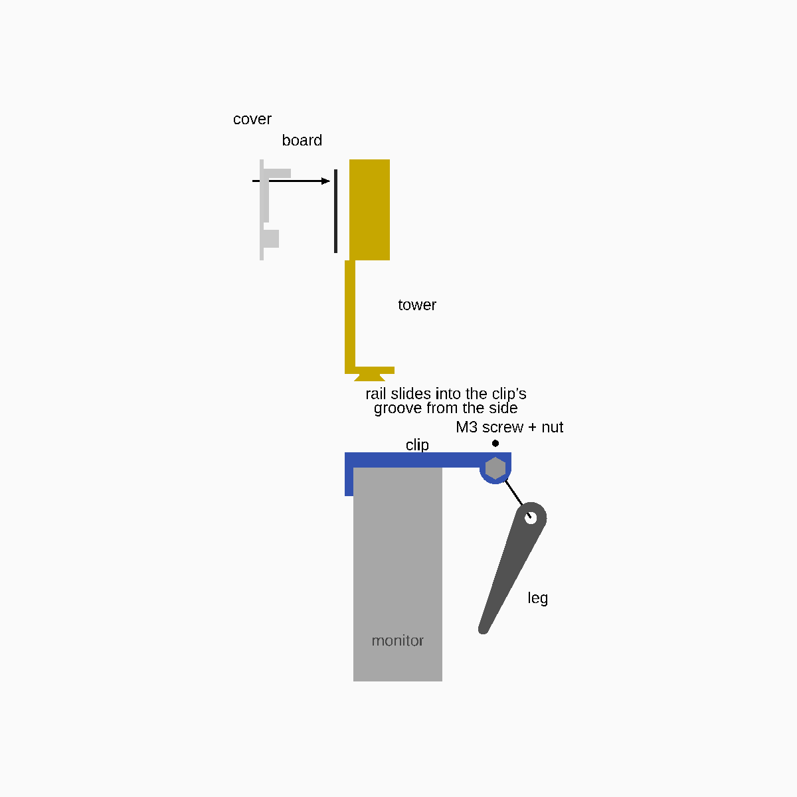
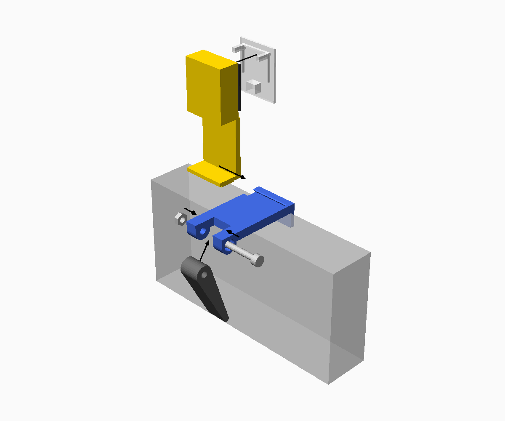

<!--
SPDX-FileCopyrightText: 2026 Curtis Galloway
SPDX-License-Identifier: Apache-2.0
-->

# Monitor-top case for the RP2040-Zero alert light

`monitor_case.scad` is a four-part OpenSCAD model:

- **clip** (opaque): sits on the monitor's top edge, with a lip over the
  front bezel and the hinge barrels at the back. A dovetail groove runs
  across the front of its top plate.
- **tower** (opaque): the rail under its foot slides into the clip's groove
  from the right (seen from the front) until it hits the groove's closed
  end; friction holds it. A wall rises from the foot to a pod
  that holds the board upright. The LED side faces the viewer, flush with the
  monitor's front, and the USB-C end points down. Under the pod is a gap,
  open at both sides and the back. The plug drops into the gap, and the
  cable bends back over the monitor's top and down its back.
- **leg** (opaque): the rear leg. It hinges on an M3 screw at the back of
  the clip and swings in until its rounded tip touches the monitor's back,
  so one clip fits monitors 15 to 35 mm thick (`monitor_min`,
  `monitor_max`). Tightening the nut sets how stiffly it swings.
- **cover** (translucent): the front window. It press-fits into the pod and
  holds the board against the pod's back wall. Its posts press on the
  board's top corners and on top of the USB-C receptacle. The window sits
  7.7 mm in front of the LED, which spreads the light.

With a straight USB-C cable, the case stands about 65 mm above the monitor.
Most of that is the 30 mm gap for the plug and the cable's bend. A
right-angle USB-C cable lets you shrink it: set `plug_len` to that plug's
length below the socket.

## Hardware

- One M3 x 20 socket-head screw
- One M3 hex nut

## Before printing: measure the plug

The cable's molded plug body: `plug_w` x `plug_d` (13 x 7.5 mm by default),
and `plug_len`, its length including the strain relief (22 mm by default).
The monitor needs no measurement as long as it is 15 to 35 mm thick at the
top edge.

## The tower joint: a friction-fit dovetail

The groove's slanted walls stop the tower lifting off, and its closed left
end stops it sliding through. How tight it holds depends on your printer,
so tune it before printing a full tower:

1. Print `part="fit_test"`: a 10 mm slice of the clip's groove and three
   short rails at 0.10, 0.15 and 0.20 mm clearance per side, marked with 1,
   2 and 3 notches. It takes about 15 minutes.
2. Slide each rail through the groove slice. Pick the one that goes in with
   firm hand pressure and does not wiggle.
3. Set `joint_fit` to that rail's clearance (0.15 mm is the default) and
   build the tower.

If even the loosest rail binds, the first layer is probably squished; check
the groove's mouth for a lip, or set `fit_tests` to looser values and
reprint.

Any tower built on the `dovetail_rail()` module fits the same clip, so
different lights can share one clip.

## Build the STLs

```bash
cd case
openscad -D 'part="clip"' -o clip.stl monitor_case.scad
openscad -D 'part="tower"' -o tower.stl monitor_case.scad
openscad -D 'part="leg"' -o leg.stl monitor_case.scad
openscad -D 'part="cover"' -o cover.stl monitor_case.scad
openscad -D 'part="fit_test"' -o fit_test.stl monitor_case.scad
```

Open the file in the OpenSCAD app with no `part` set to see the parts on a
ghost monitor, board and plug. Set `monitor_t` to preview the leg's angle on
a monitor of that thickness.

## Printing

- **clip**: comes out face down, with the top plate on the bed and the lip
  and hinge barrels pointing up. No supports.
- **tower** and **leg**: each comes out lying on its side. Print them that
  way, with no supports. The pod's far side wall bridges about 24 mm.
- **fit_test**: the groove slice comes out face down and the rails stand on
  end, the same way the clip and tower print. No supports.
- **cover**: comes out face down. Print it in translucent (natural) PETG or
  PLA. A 1.2 mm window (`cover_t`) diffuses well; go thinner for more light.

## Assembly





Both diagrams come from `exploded.scad`; its header has the render commands.

1. Slide the tower's rail into the clip's groove from the right, as seen from
   the front, until it stops. Its front and sides end flush with the clip's.
2. Press the M3 nut into the hex pocket on one hinge knuckle.
3. Set the leg's knuckle between the clip's knuckles and push the screw
   through from the other side. Snug it until the leg holds its position.
4. Drop the board into the pod, USB-C end down and LED facing out.
5. Press the cover in. If it is loose, lower `rim_fit` or add a dot of glue.
6. Plug the cable in from below, reaching into the gap from the side.
7. Set the clip on the monitor with the lip over the front, swing the leg in
   against the back, and lay the cable back over the top and down the back.
